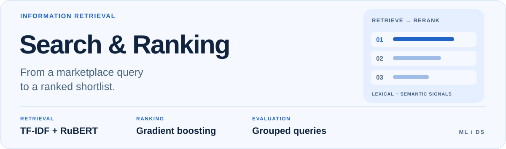
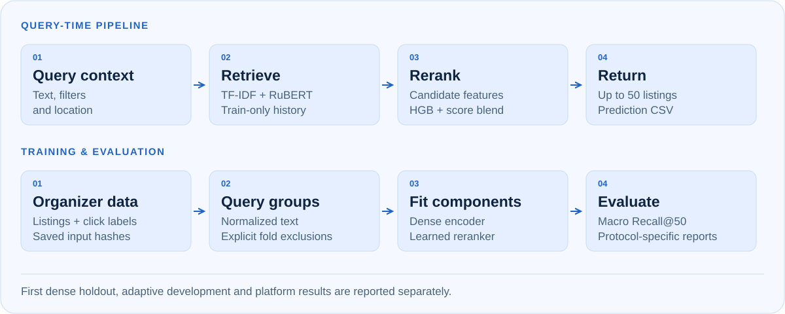

<picture>
  <source media="(max-width: 600px) and (prefers-color-scheme: dark)" srcset="docs/assets/readme/cover-dark-mobile.svg">
  <source media="(max-width: 600px)" srcset="docs/assets/readme/cover-light-mobile.svg">
  <source media="(prefers-color-scheme: dark)" srcset="docs/assets/readme/cover-dark.svg">
  
</picture>

<p align="center">
  <a href="#architecture">Architecture</a> &nbsp;·&nbsp;
  <a href="#results-and-evidence">Results</a> &nbsp;·&nbsp;
  <a href="#reproduce">Run locally</a> &nbsp;·&nbsp;
  <a href="docs/experiment-log.md">Experiment log</a> &nbsp;·&nbsp;
  <a href="#read-the-implementation">Source map</a>
</p>

## Overview

**Hybrid retrieval and learned reranking for Russian service listings.**

A local search pipeline that returns up to 50 listings per query. It combines
lexical matching, a fine-tuned RuBERT bi-encoder, behavioral signals and gradient
boosting. This repository is a personal bootcamp project on organizer-provided
data; it does not describe Avito's internal search system.

<a id="pipeline"></a>

## Architecture

<picture>
  <source media="(max-width: 600px) and (prefers-color-scheme: dark)" srcset="docs/assets/readme/architecture-dark-mobile.svg">
  <source media="(max-width: 600px)" srcset="docs/assets/readme/architecture-light-mobile.svg">
  <source media="(prefers-color-scheme: dark)" srcset="docs/assets/readme/architecture-dark.svg">
  
</picture>

The query-time path merges lexical, dense and behavioral candidates, builds
metadata and similarity features, then blends the learned reranker with the
retrieval score. The training path fits the dense encoder and reranker under
the fold exclusions recorded in the experiment protocol.

| Component | Implementation |
| --- | --- |
| Lexical retrieval and train-only behavioral signals | [`model.py`](src/avito_retrieval/model.py) |
| Fine-tuned bi-encoder, hard negatives and dense index | [`dense.py`](src/avito_retrieval/dense.py) |
| Candidate features, HGB training and ranked output | [`reranker.py`](src/avito_retrieval/reranker.py) |
| Data audit, command-line entry point and evaluation | [`audit.py`](src/avito_retrieval/audit.py) · [`cli.py`](src/avito_retrieval/cli.py) · [`evaluation.py`](src/avito_retrieval/evaluation.py) |

The dense encoder uses in-batch negatives and mined hard negatives. Evaluation
groups normalized query text to keep held-out query history out of training.
The offline catalog contains 515,895 listings; it differs from the submission
catalog, so offline and platform scores are reported separately.

## Results and evidence

Metric: macro **Recall@50** over aggregated query units. These are previously
recorded repository results, not new runs performed for this README update.

| Comparison | Protocol | Recall@50 | Interpretation |
| --- | --- | ---: | --- |
| HGB47 | Reserved round-6 holdout, 1,200 queries | 0.803833 | Lexical/behavioral reference |
| First dense HGB52 | Same holdout, first evaluation | 0.860736 | Delta +0.056903; cluster-bootstrap 95% CI [0.040253, 0.073896] |
| Hard negatives + larger HGB52 | Same holdout reused during development | 0.867569 | Adaptive development result; not a new independent confirmation |

The final encoder additionally uses folds 3–4. Its independent holdout effect
and latest platform score are unknown. The published platform score 0.878067
belongs to the **first** dense version. It must not be attributed to the final
hard-negative model. Click labels are incomplete and reflect historical exposure.

## Reproduce

Python 3.12. Download the organizer archive linked in the
[full protocol](docs/experiment-log.md#установка-и-данные), verify the saved input
hashes, and place its three Parquet files in `data/`.

```bash
git clone https://github.com/ssivitskii/ds-bootcamp-avito.git
cd ds-bootcamp-avito
python3.12 -m venv .venv
.venv/bin/pip install -r requirements.txt
.venv/bin/pip install -e .
.venv/bin/avito-retrieval audit --data-dir data --output artifacts/audit.json

PYTHONHASHSEED=2027 OMP_NUM_THREADS=4 OPENBLAS_NUM_THREADS=4 \
.venv/bin/avito-retrieval predict --data-dir data --config config.json \
  --weights-json artifacts/evaluation.json \
  --reranker-config reranker_dense_config.json --cache-dir cache --output answer.csv

PYTHONPATH=src .venv/bin/python -m unittest discover -s tests -v
```

Dense training on MPS is not bitwise deterministic. The standard
`evaluate-reranker` command currently reproduces the lexical comparison, **not**
the dense holdout tables. This remains a reproducibility limitation.

## Read the implementation

- [Dense training and hard-negative mining](src/avito_retrieval/dense.py)
- [Candidate features and reranker](src/avito_retrieval/reranker.py)
- [Grouped evaluation](src/avito_retrieval/evaluation.py)
- [Full experiment history, ablations, data provenance and limitations](docs/experiment-log.md)

The experiment log retains all earlier results, failed ideas and commands.

---

[← Back to portfolio](https://github.com/ssivitskii#selected-work)
